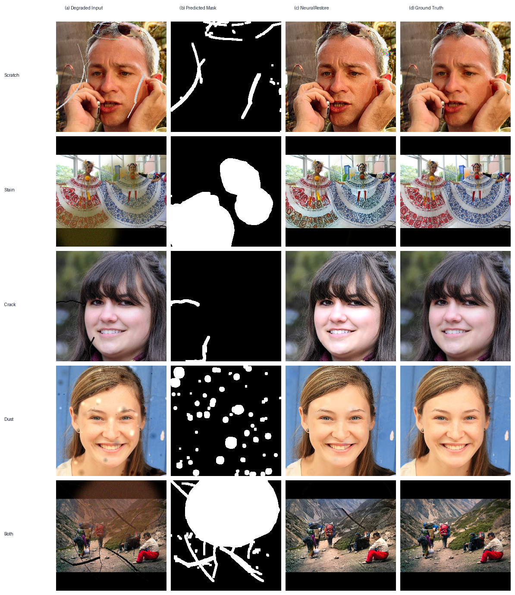

<div align="center">

# 🖼️ NeuralRestore

### AI-Powered Image Restoration Pipeline

**Automatically detect and repair scratches, stains, cracks, dust, noise, and blur in damaged images using a 5-model deep learning pipeline.**

[](https://python.org)
[](https://pytorch.org)
[](LICENSE)
[](https://huggingface.co/sp533/NeuralRestore)
[](https://www.kaggle.com/datasets/vgp275/neuralrestore)

---



*Qualitative results across damage types — (a) Degraded Input → (b) Predicted Mask → (c) NeuralRestore Output → (d) Ground Truth*

</div>

---

## ✨ Features

- 🔍 **Automatic Damage Detection** — no manual masking needed; the model finds and segments damage itself
- 🧠 **5-Model Sequential Pipeline** — detects → inpaints → denoises → deblurs → upscales
- 🎨 **Handles Any Image** — color, grayscale, sepia, old photographs, scanned documents
- 🖥️ **Runs Fully Local** — no internet or cloud API dependency after setup
- 🎛️ **Beautiful Gradio UI** — drag-and-drop interface with real-time damage analysis reports
- ⚡ **GPU Accelerated** — supports CUDA (NVIDIA) and MPS (Apple Silicon)

---

## 🏗️ Architecture

NeuralRestore runs a **5-model deep learning pipeline** sequentially. The execution order is carefully designed: structural restoration (inpainting) happens before frequency adjustments (denoising/deblurring), and denoising runs before deblurring to prevent amplifying high-frequency noise.

```
📸 Damaged Image
       │
       ▼
 ┌─────────────────────────────────────────────┐
 │  Model 1 │ Damage Detector                  │
 │           EfficientNet-B4 + UNet            │
 │           → Binary mask + 4-class labels    │
 └────────────────────┬────────────────────────┘
                      │
               ┌──────┴──────┐
               │ Damage      │
               │ Found?      │
               └──┬──────┬───┘
              Yes │      │ No
                  ▼      │
 ┌────────────────────┐  │
 │  Model 2 │ Inpaint │  │
 │  LaMa FFC Generator│  │
 └────────┬───────────┘  │
          │    ┌─────────┘
          ▼    ▼
 ┌─────────────────────────────────────────────┐
 │  Model 3 │ Denoising          (always)      │
 │           DnCNN (17 layers)                 │
 └────────────────────┬────────────────────────┘
                      ▼
 ┌─────────────────────────────────────────────┐
 │  Model 4 │ Deblurring         (always)      │
 │           NAFNet                            │
 └────────────────────┬────────────────────────┘
                      ▼
 ┌─────────────────────────────────────────────┐
 │  Model 5 │ Super Resolution   (optional)    │
 │           Real-ESRGAN 4×                    │
 └────────────────────┬────────────────────────┘
                      ▼
                 ✅ Restored HD Image
```

### Model Details

| # | Model | Architecture | Task | Input Size |
|:-:|---|---|---|---|
| 1 | Damage Detector | EfficientNet-B4 + UNet | Binary mask + 4-class labels | 256 × 256 |
| 2 | Inpainting | LaMa (FFC ResNet, 9 blocks) | Fill damaged regions | 256 × 256 + mask |
| 3 | Denoising | DnCNN (17 layers, residual) | Remove Gaussian/Poisson noise | 256 × 256 |
| 4 | Deblurring | NAFNet (SimpleGate + SCA) | Remove motion/defocus blur | 256 × 256 |
| 5 | Super Resolution | Real-ESRGAN (RRDBNet, 23 blocks) | 4× upscale | Any size |

---

## 🚀 Quick Start

### 1. Clone the Repository

```bash
git clone https://github.com/vrajptl275/neuralrestore.git
cd neuralrestore
```

### 2. Create Environment & Install Dependencies

**Option A — Conda (recommended):**

```bash
conda create -n img python=3.10 -y
conda activate img
pip install -r requirements.txt
```

**Option B — pip:**

```bash
python -m venv venv
source venv/bin/activate   # Windows: venv\Scripts\activate
pip install -r requirements.txt
```

### 3. Download Model Weights

All pre-trained weights are hosted on [🤗 HuggingFace](https://huggingface.co/sp533/NeuralRestore). Download them with a single command:

```bash
python download_weights.py
```

| File | Model | Size |
|---|---|---|
| `model1_best_v2.pth` | Damage Detector (EfficientNet-B4 + UNet) | ~80 MB |
| `model2_best_v3.pth` | Inpainting (LaMa FFC Generator) | ~200 MB |
| `model3_best.pth` | Denoising (DnCNN) | ~7 MB |
| `model4_best.pth` | Deblurring (NAFNet) | ~270 MB |
| `RealESRGAN_x4.pth` | Super Resolution (Real-ESRGAN 4×) | ~64 MB |

### 4. Launch the App

```bash
python run.py
```

The Gradio UI will open automatically at **[http://localhost:7860](http://localhost:7860)**.

```bash
# Additional options:
python run.py --port 8080     # Custom port
python run.py --share          # Create public Gradio URL
python run.py --no-browser     # Don't auto-open browser
```

---

## 💻 CLI Usage

You can also run the pipeline directly from the command line without the UI:

```bash
# Full pipeline (with 4× super resolution)
python -m src.pipeline --image path/to/damaged.png --output outputs/restored.png

# Skip super resolution (faster)
python -m src.pipeline --image path/to/damaged.png --output outputs/restored.png --no_sr
```

---

## ⚙️ Configuration

| Parameter | Default | Description |
|---|---|---|
| `mask_threshold` | `0.25` | Detection sensitivity — lower values detect more damage (try `0.10`–`0.15` for subtle stains/dust) |
| `mask_dilation` | `5` | Expand detected mask by N pixels — helps inpainting blend edges cleanly |
| `use_tta` | `True` | Test-Time Augmentation — runs 4 flip variants for more robust mask prediction |
| `apply_sr` | `True` | Apply 4× super resolution as the final step |

---

## 📁 Project Structure

```
neuralrestore/
├── run.py                      # 🚀 Entry point — launches Gradio UI
├── download_weights.py         # 📥 Downloads all weights from HuggingFace
├── requirements.txt            # 📦 Python dependencies
├── LICENSE                     # 📄 MIT License
├── README.md                   # 📖 This file
├── .gitignore
│
├── src/                        # Main source package
│   ├── __init__.py
│   ├── app.py                  # 🎛️ Gradio web interface
│   ├── pipeline.py             # 🔄 Pipeline orchestrator (connects all 5 models)
│   ├── config.py               # ⚙️ Central configuration & constants
│   │
│   ├── models/                 # 🧠 Model architectures
│   │   ├── __init__.py
│   │   ├── damage_detector.py  # Model 1 — EfficientNet-B4 + UNet
│   │   ├── inpainting.py       # Model 2 — LaMa FFC Generator
│   │   ├── denoising.py        # Model 3 — DnCNN (17 layers)
│   │   ├── deblurring.py       # Model 4 — NAFNet
│   │   └── super_resolution.py # Model 5 — Real-ESRGAN wrapper
│   │
│   └── utils/                  # 🔧 Shared utilities
│       ├── __init__.py
│       └── image.py            # Image loading, padding, tensor conversion
│
├── weights/                    # 🏋️ Model weight files (.pth) — see download step
├── outputs/                    # 📤 Restored output images
│
└── docs/                       # 📚 Documentation
    ├── architecture.md         # Pipeline & model architecture reference
    ├── training.md             # Training configs, losses, metrics
    └── figures/                # Sample images & result visualizations
        ├── dataset_samples/    # Training data examples
        └── restoration_results/# Qualitative result comparisons
```

---

## 📊 Training

### Dataset

The complete training dataset (~19 GB across 4 models) is hosted on Kaggle:

> 📦 **[vgp275/neuralrestore on Kaggle](https://www.kaggle.com/datasets/vgp275/neuralrestore)**

```python
import kagglehub
path = kagglehub.dataset_download("vgp275/neuralrestore")
print("Path to dataset files:", path)
```

Or via Kaggle CLI:
```bash
kaggle datasets download -d vgp275/neuralrestore --unzip -p data/dataset
```

| Model | Task | Train | Val | Test | Total |
|---|---|---:|---:|---:|---:|
| Model 1 | Damage Detection | 37,920 | 4,740 | 4,740 | 47,400 |
| Model 2 | Inpainting | 37,920 | 4,740 | 4,740 | 47,400 |
| Model 3 | Denoising | 6,320 | 790 | 790 | 7,900 |
| Model 4 | Deblurring | 6,320 | 790 | 790 | 7,900 |

### Loss Functions

| Model | Loss | Target Metrics |
|---|---|---|
| Damage Detector | 0.5×(BCE + Dice) + 0.5×BCEWithLogits | IoU > 0.85 |
| Inpainting | L1 + 0.2×Perceptual + 0.2×FFT + 0.05×PatchGAN | PSNR > 30 dB, SSIM > 0.90 |
| Denoising | L1 + 0.2×Perceptual | PSNR > 35 dB, SSIM > 0.95 |
| Deblurring | PSNR Loss + Perceptual | PSNR > 32 dB, SSIM > 0.92 |
| Super Resolution | *Pretrained (no training needed)* | — |

> 📖 See [docs/training.md](docs/training.md) for full training configurations and [docs/architecture.md](docs/architecture.md) for model architecture details.

---

## 🔧 Requirements

- **Python** ≥ 3.9
- **PyTorch** ≥ 2.0
- **GPU** — CUDA (NVIDIA) or MPS (Apple Silicon) recommended; CPU supported but slower

<details>
<summary>📋 Full dependency list</summary>

```
torch>=2.0.0
torchvision>=0.15.0
segmentation-models-pytorch==0.3.4
timm==0.9.7
opencv-python>=4.8.0
Pillow>=10.0.0
numpy>=1.24.0
albumentations>=1.3.1
torchmetrics>=1.3.0
realesrgan
basicsr
gradio>=4.0.0
tqdm
matplotlib
huggingface_hub
```

</details>

---

## 📄 License

This project is licensed under the **MIT License** — see the [LICENSE](LICENSE) file for details.

---

<div align="center">

**Built with ❤️ using PyTorch**

EfficientNet-B4 · LaMa · DnCNN · NAFNet · Real-ESRGAN

</div>
